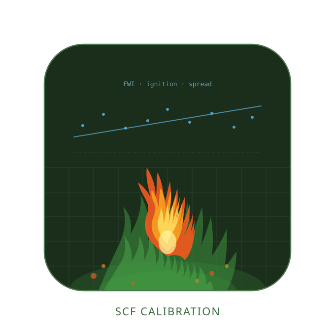

<p align="center">
  
</p>

# SCF Fire Calibration Shiny App

An interactive R Shiny application for calibrating the
[LANDIS-II Social-Climate-Fire (SCF) v4](https://github.com/LANDIS-II-Foundation/Extension-Social-Climate-Fire)
extension. It produces, from public fire and climate data:

- ignition coefficients and ignition maps
- spread probability coefficients
- maximum daily spread area coefficients
- site and cohort mortality coefficients
- the species bark-thickness table

It also tests parameter sets against observed fire sizes before (and after)
you run LANDIS.

> **Read [`docs/SCF_semantics.md`](docs/SCF_semantics.md) first.** It explains
> what SCF actually does with each parameter: single-trial spread, MaxSpreadArea
> as pacing, inverted mortality signs, keyword order and wind units. Several of
> these behaviours mean a fitted coefficient cannot be pasted into SCF as is.

---

## Contents

1. [Quick Start](#1-quick-start)
2. [Required Data](#2-required-data)
3. [App Structure](#3-app-structure)
4. [Sidebar — Landscape Setup](#4-sidebar--landscape-setup)
5. [Ignition Calibration](#5-ignition-calibration)
6. [Species Table](#6-species-table)
7. [Spread Calibration](#7-spread-calibration)
8. [Mortality Calibration](#8-mortality-calibration)
9. [Model Validation](#9-model-validation)
10. [Parameter Tuning](#10-parameter-tuning)
11. [Session — Save and Restore](#11-session--save-and-restore)
12. [Putting Parameters into SCF](#12-putting-parameters-into-scf)
13. [Output Files Reference](#13-output-files-reference)
14. [Troubleshooting](#14-troubleshooting)
15. [Data Sources & Citations](#15-data-sources--citations)

---

## 1. Quick Start

### Prerequisites

- R 4.4.x and RStudio (recommended)
- The `renv` package for reproducible package management

### Installation

```r
# 1. Clone the repository
#    git clone https://github.com/jameslamping/Shiny_SCF_Calibration

# 2. Open app.R in RStudio — renv activates automatically via .Rprofile
#    OR from the R console in the project directory:

install.packages("renv")          # if not already installed
renv::restore()                   # installs all packages at exact locked versions
                                  # (~5–10 min on first run)

# 3. Set your default file paths (optional, recommended)
#    Copy user_paths_template.R to user_paths.R and fill in your paths.
#    user_paths.R is gitignored, so your paths stay on your machine.

# 4. Launch the app
shiny::runApp()
```

On start-up the R console says how many default paths were loaded and lists
any that don't exist on this machine.

`renv::restore()` reads `renv.lock` and installs every package at the exact
version used during development, including GitHub-sourced packages
(`climateR`, `rFIA`, `ncmeta`, `rnz`).

To update the lockfile after adding or upgrading packages:

```r
renv::snapshot()
# then commit renv.lock
```

### Windows and macOS

The app is developed on macOS and used on Windows. The same `renv.lock` works
on both because renv installs the right binaries for each OS.

- **R version:** use R 4.4.x. The lockfile was recorded with R 4.4.2. R 4.5
  usually works, but renv will warn about the version mismatch.
- **No Rtools needed:** every package is either a CRAN binary or pure R,
  including the GitHub-only `climateR`, `ncmeta`, `rFIA` and `rnz`.
- **GitHub rate limit:** if `renv::restore()` fails on those GitHub packages
  with an HTTP 403 error, GitHub's anonymous download limit has been hit. Wait
  an hour, or set a `GITHUB_PAT` in your `.Renviron` file, then retry.
- **File paths:** paste paths in any form. `C:\data\fwi.nc`, `C:/data/fwi.nc`
  and a quoted path from Explorer's "Copy as path" are all normalised to
  forward slashes when entered.
- **Default paths:** every path box starts empty unless you set it in your own
  `user_paths.R` (see Quick Start). Write paths there with forward slashes,
  e.g. `"C:/data/fwi.nc"`: a single backslash in an R string is an escape
  character.
- **Sharing the lockfile:** if you install a new package on either OS, run
  `renv::snapshot()` and commit `renv.lock`. Don't commit `renv/library/`;
  it is OS-specific and already gitignored.

---

## 2. Required Data

Large inputs are not in the repository. Download the local ones once; the
remote ones are fetched by the app when you click the matching button.

| Data | Used for | How |
|------|----------|-----|
| ERA-Interim FWI (`fwi.nc`, `ffmc.nc`, `dmc.nc`, `dc.nc`) | FWI, if you choose the ERA source | Local, ~28 GB — Vitolo et al. 2019, <https://doi.org/10.5281/zenodo.1065400> |
| GRIDMET meteorology | FWI (GRIDMET source) and all wind | Remote (OPeNDAP), CONUS 1979–present; cached in `gridmet_cache/` |
| LANDIS daily climate CSV | Runtime FWI check | Local — the climate file your LANDIS runs use |
| FPA FOD `FPA_FOD_20221014.gdb` | Ignitions, observed fire sizes | Local, ~500 MB — Short 2022, <https://doi.org/10.2737/RDS-2013-0009.6> |
| Fire perimeters: NIROPS (2020–2024), FIRED daily + events (2001–2019) or GeoMAC (2000–2018) | Spread | Local |
| DEM | Slope and aspect for effective wind | Remote (`elevatr`) |
| LANDFIRE FBFM40 | Fine fuels (spread B2, severity B5) | Remote (LFPS REST) or a local 0–1 GeoTIFF |
| LANDFIRE canopy (CBD, CBH, CH) | Ladder fuel biomass (severity B6) | Remote, or a local g m⁻² raster |
| MTBS dNBR | Site severity response | Remote (MTBS ImageServer) or local per-fire TIFFs |
| SOLUS100 / SoilGrids clay | Severity B1 | Local directories |
| TerraClimate PET and CWD | Severity B2, B4 | Remote (4 km) or local annual rasters |
| Fire and Tree Mortality database (Cansler et al. 2020) | Cohort mortality; bark coefficients | Local, RDS-2020-0001-2 |
| FIA tree tables | Species table (DBH, age) | Remote via `rFIA`, or local `{STATE}_TREE.csv` |

**Choose one FWI source for everything.** SCF applies one FWI stream to both
ignition and spread, so calibrate both on the same source and convention.
NIROPS perimeters (2020–2024) need the GRIDMET source, because ERA-Interim
ends in 2018.

---

## 3. App Structure

```
scf_calibration_app/
├── app.R                        # UI + server (all tabs)
├── renv.lock                    # Pinned package versions
├── .Rprofile                    # Auto-activates renv on project open
├── user_paths_template.R        # Copy to user_paths.R (gitignored) for your default paths
├── docs/
│   └── SCF_semantics.md         # What SCF does with each parameter — read first
├── modules/
│   ├── era_helpers.R            # ERA-Interim FWI, GRIDMET met + cffdrs FWI, GRIDMET wind,
│   │                            #   LANDIS Climate Library runtime FWI, startup codes
│   ├── ignition_helpers.R       # FPA FOD, Poisson/ZIP fitting, ignition surfaces, area offset
│   ├── spread_helpers.R         # Perimeters (NIROPS/FIRED/GeoMAC), terrain, EWS, spread and
│   │                            #   MaxSpreadArea fitting, candidate scoring, SCF snippet
│   │                            #   formatting (scf_num / scf_kv)
│   ├── mortality_helpers.R      # Clay, MTBS, TerraClimate, ladder fuels, site/cohort fits
│   ├── species_helpers.R        # FIA DBH/age, FOFEM bark coefficients, species table
│   ├── tuning_helpers.R         # SCF-faithful fire simulator, real-weather ensemble,
│   │                            #   B0 sweep, tuning plots, tuning export
│   ├── validation_helpers.R     # SCF events-log reader, validation plots, FRI
│   └── user_paths.R             # Reads the per-user user_paths.R
├── analysis/                    # Stand-alone analysis scripts
└── spread_probability_diagnostic.R  # Step-through script for the spread pipeline
```

### Spatial design

| Object | Purpose |
|--------|---------|
| **Calibration boundary** (`cal_vect`) | Large regional polygon (e.g. an ecoprovince). Clips FWI, wind, FPA FOD and perimeters. Large enough to capture the fire climate driving your landscape. |
| **LANDIS template raster** (`template_r`) | Your LANDIS grid. Sets the working CRS, cell size and extent for all output maps, and the grid used by the fire simulator. |

All data are reprojected to the CRS of `template_r`. Maps display in EPSG:4326.

---

## 4. Sidebar — Landscape Setup

Complete these steps before any calibration tab.

| Step | Input | Notes |
|------|-------|-------|
| 1 | **Calibration Boundary** | A shapefile, or US states downloaded with `tigris`. |
| 2 | **LANDIS Template Raster** | Any LANDIS input raster (e.g. ecoregions). Sets cell size and CRS. |
| 3 | **Fire Weather Index** | **ERA-Interim** (local NetCDF, to 2018) or **GRIDMET-derived** (computed with `cffdrs`, to present). See the settings below this table. |
| 4 | **GRIDMET Wind** | Daily wind speed and direction, fetched remotely, converted m/s → km/h. |
| 5 | **Calibration Period** | Year range used across all tabs. |

GRIDMET FWI settings (step 3):

- **FWI convention:** use `landis` (daily mean temperature and RH), the way the
  Climate Library computes it.
- **Climate Library version:** match the library your LANDIS runs use.
- **Runtime FWI check:** load your LANDIS climate CSV to compute the FWI SCF
  will actually see. It is used by the Spread diagnostics and by the Parameter
  Tuning ensemble and B0 sweep.

---

## 5. Ignition Calibration

Fits daily ignition counts against FWI from FPA FOD, separately for
Lightning and Accidental ignitions.

```
Poisson:  λ = exp(b0 + b1 × FWI)
ZIP:      π = plogis(bz0 + bz1 × FWI)   (probability of a structural zero)
          E[n] = (1 − π) × λ            (matches SCF, PlugIn.cs:818)
```

ZIP is fitted with `pscl::zeroinfl()`. Expect b1 > 0 and bz1 < 0.

### Workflow

1. Enter the path to `FPA_FOD_20221014.gdb`.
2. Choose Poisson or ZIP.
3. Click **Run Ignition Calibration**.
4. Review **Coefficients** and **Diagnostics**.
5. Open **Scale Adjustment** to convert the regional b0 to your landscape:
   - **Option A (recommended):** add log(landscape area / boundary area).
   - **Option B:** refit b0 on fires inside the template.
6. Download ignition surfaces and terrain maps from **Landscape Maps**.

Ignition surfaces are a Gaussian kernel of observed ignitions on the template
grid (`terra::focal`), written as INT4S 0–100 rasters.

### Sub-tabs

| Sub-tab | Content |
|---------|---------|
| **Method** | Walkthrough of the pipeline |
| **Overview Map** | FPA FOD ignitions by type |
| **Coefficients** | b0, b1, bz0, bz1 per type; CSV |
| **Scale Adjustment** | Area offset or park intercept; adjusted coefficients |
| **LANDIS Validation** | SCF events-log ignition counts vs the expected range |
| **Diagnostics** | Observed vs fitted, zero-inflation, count component, residuals |
| **ERA Startup Codes** | FFMC/DMC/DC startup values from climatology |
| **Landscape Maps** | Ignition surfaces, slope, uphill azimuth, blank suppression maps |

---

## 6. Species Table

Builds `Fire_Spp_Table.csv`, which SCF uses for bark thickness:

```
BarkThickness = (MaximumBarkThickness × Age) / (Age + AgeDBH)
```

**Bark thickness is single-sided, in cm.**
`MaximumBarkThickness = BT_coef × P95_DBH_cm`, where `BT_coef` is the FOFEM
coefficient. It is read from the Cansler FTM `Species_BarkThickness.csv` when
the FTM directory is set, so the species table and the cohort mortality fit
share one set of coefficients. There is **no factor of 2**: doubling it roughly
halves simulated mortality. `AgeDBH` comes from a Michaelis–Menten DBH-age fit
to FIA aged trees, with a heuristic fallback when fewer than 15 aged records
exist.

### Workflow

1. **Load the species lookup CSV.** Columns:
   - `SpeciesName`: the LANDIS species code
   - `FIA_SPCD`: verify it against
     [REF_SPECIES.csv](https://apps.fs.usda.gov/fia/datamart/CSV/REF_SPECIES.csv)
   - `SCIENTIFIC_NAME`

   Check the SPCD mismatch warnings carefully.
2. **Choose species:** all in the lookup, those in a NECN species CSV, or a
   manual list. Click **Build Species Table**.
3. **Fetch FIA Bark Parameters** for the selected states. Optionally point to
   a local directory of `{STATE}_TREE.csv` files.

Sub-tabs: **Species Parameters** (editable), **Bark Thickness Curves**,
**Species Lookup Table**.

---

## 7. Spread Calibration

Fits SCF's spread probability and maximum daily spread area from daily fire
perimeter progressions.

### Models

```
P(spread)     = 1 / (1 + exp(−(B0 + B1·FWI + B2·FineFuels + B3·EWS)))
MaxSpreadArea = (int)(B0 + B1·FWI + B2·EWS)      hectares per day
EWS           = Cb·√((Ua/Cb)² + 2(Ua/Cb)·sin θ·cos φ + sin² θ)   (Nelson 2002, km/h)
```

- **Spread probability:** a binomial GLM on sequential perimeter pairs. The
  default calibration level is the **fire-day aggregate**, which models the
  fraction of frontier cells that burned per fire-day (B2 is 0 in this mode).
  By default each perimeter gets the FWI of the GRIDMET cell it sits in
  ("Use per-fire FWI").
  - **Only the slopes (B1, B3) come from the regression.** Spread in SCF is
    single-trial percolation, and case-control sampling biases the intercept,
    so **B0 must be set by simulation**. Use Parameter Tuning > **B0 Sweep**,
    then confirm with LANDIS runs in **Score Candidates**.
- **MaxSpreadArea:** quantile regression (`quantreg`) on raw ha/day, with no
  log transform; the 75th percentile is recommended.
  - It **paces** the fire (cells per day). It does not cap fire size.
  - Keep B0 > 0. Below zero, SCF burns one cell per day. The
    coefficient-constraint option enforces B0 ≥ 50 ha.
- **EWS:** wind in km/h; slope and aspect from a DEM; combustion buoyancy Cb
  chosen in the inputs (10, 25 or 50).

### Workflow

1. Choose the perimeter source: **NIROPS** (recommended; needs GRIDMET FWI),
   **FIRED**, or **GeoMAC**.
2. Set cleaning thresholds, rasterization, sampling, fine fuels source, season
   filters and predictors.
3. Click **Run Spread Fitting**; review **Fit Coefficients** and **Diagnostics**.
4. Check **Terrain**: EWS should exceed raw wind on upslope runs.
5. Set B0 with **Parameter Tuning > B0 Sweep**.
6. Optionally build a **Candidate Grid**, run LANDIS for each candidate, and
   rank them in **Score Candidates**.

### Sub-tabs

| Sub-tab | Content |
|---------|---------|
| **Method** | Walkthrough of the pipeline |
| **Fit Coefficients** | Both models' coefficients; CSV |
| **Maps** | Fine fuels; calibration fires |
| **Diagnostics** | P(spread) vs FWI/wind, percolation check against runtime FWI, observed vs predicted daily area |
| **Terrain** | EWS vs raw wind, slope, wind–upslope alignment |
| **Perimeter Pairs** | Cleaned perimeter progression table; CSV |
| **Candidate Grid** | Grid of spread B0 × B1. Exports one SCF snippet per candidate (.zip, each with its B0 and B1) |
| **Threshold Search** | Cleaning/sampling thresholds scored by AUC × R² |
| **Score Candidates** | Ranks candidate LANDIS runs (see below) |
| **Fire Growth Animation** | Animated perimeter progression for one fire |

### Score Candidates

Put each LANDIS run in `<runs root>/candidate_0001/`, `candidate_0002/` and so
on, matching the Candidate Grid IDs. The `socialclimatefire-events-log.csv` can
be anywhere inside each folder. Each run gets two scores, both mean |log ratio|
(0 = perfect, 0.69 = off by a factor of 2):

- **Fire size:** the 10th–90th percentiles of fires larger than one cell and no
  larger than the landscape, against FPA FOD.
- **Annual area:** the mean fraction of the landscape burned per year (the fire
  rotation), against the observed fraction of the calibration boundary.
  Simulation years are not matched to calendar years.

A run that burns nothing ranks last. Missing runs are reported in a status
column.

---

## 8. Mortality Calibration

Fits SCF's site severity (dNBR) and cohort mortality models. Signs and units
matter here more than anywhere else; see
[`docs/SCF_semantics.md` §6](docs/SCF_semantics.md#6-mortality).

```
Site:    eta = B0 + B1·Clay + B2·PET + B3·EWS + B4·CWD + B5·FineFuels + B6·LadderFuels
         dNBR = max(eta, 0.0005)⁻¹                 (Gamma GLM, inverse link)
Cohort:  P = exp(B0 + B1·BarkThickness + B2·SiteMortality);  p = P/(1+P)
```

- **Signs are inverted** in the site model: B0 > 0, and anything that raises
  severity has a negative coefficient. The fit reports how many pixels reach
  the 0.0005 floor (dNBR 2000); anything above 0% is a scale error.
- **LadderFuels is raw biomass in g m⁻², not an index.** It is built from
  LANDFIRE canopy bulk density × canopy depth below the ladder ceiling, and must
  match `LadderFuelMaxAge` and `LadderFuelSpeciesList`.
- **Cohort mortality** uses the Fire and Tree Mortality database, with
  cluster-robust standard errors by fire. Expect B1 < 0 and B2 > 0.

### Inputs

| Input | Source |
|-------|--------|
| Clay | SOLUS100 + SoilGrids (fraction 0–1) |
| dNBR | MTBS: download automatically or point to local per-fire TIFFs. Prefer continuous RdNBR over the 6-class thematic mosaic. |
| PET and CWD | TerraClimate (remote) or local annual rasters, mm/yr |
| EWS | Computed from the wind series and terrain (Nelson 2002); run Spread Calibration first for slope and aspect, otherwise raw wind is used |
| Fine fuels | Reused from the Spread tab, otherwise LANDFIRE FBFM40 fetched at fit time |
| Ladder fuels | LANDFIRE canopy biomass (remote), a local g m⁻² raster, or None (B6 = 0) |
| Cohort data | Fire and Tree Mortality database directory |

Sub-tabs: **Site Mortality Coefficients**, **Diagnostics**, **Data Summary**,
**Parameter Snippet**, **Model Validation**.

---

## 9. Model Validation

Compares a LANDIS run's `socialclimatefire-events-log.csv` (or the folder
containing it) against observed data.

| Sub-tab | Content |
|---------|---------|
| **Ignitions** | Annual ignition counts, observed vs simulated |
| **Fire Size Distribution** | ECDF of fire sizes (fires ≥ one cell) |
| **Annual Area Burned** | Calibration boundary and landscape scales |
| **Fire-Climate Relationship** | Fire size by FWI and EWS bin |
| **Annual Count vs FWI** | Ignitions vs FWI |
| **Severity (dNBR)** | Simulated vs MTBS severity, and against EWS |
| **Fire Duration** | Simulated vs observed fire durations |
| **Fire Return Interval** | SCF fire maps vs LANDFIRE mean FRI |

---

## 10. Parameter Tuning

Explore and test a full parameter set before running LANDIS.

- **Parameters sidebar:** start by clicking **← Load from Calibration**; until
  then it holds placeholder defaults. Every panel uses these values.
- **`MaximumFineFuels` defaults to 900 g C m⁻²**, the load the calibration
  scaled FineFuels = 1.0 to.

| Sub-tab | Content |
|---------|---------|
| **Observed Targets** | FPA FOD size distribution and MTBS severity to aim for |
| **Overview** | All equations at the current values |
| **Ignitions** | Fits and diagnostics for the tuned ignition coefficients |
| **Max Spread Area** / **Spread Probability** | Response surfaces against FWI and EWS |
| **Fine Fuels** | `MaximumFineFuels` scaling and saturation check. If you raise it, it tells you the factor to multiply B2 and B5 by. |
| **Site Mortality** / **Cohort Mortality** | Predicted dNBR and cohort mortality curves |
| **Fire Simulation** | One fire on a 100×100 grid using SCF's spread rules |
| **Fire Size Distribution** | Many fires, on **real daily weather** (default) or a constant FWI × EWS grid |
| **B0 Sweep** | Sets `SpreadProbabilityB0` (or B0 and B1 jointly) by simulation |

### The fire simulator

`simulate_fire_simple()` is a port of SCF's spread loop:

- a FIFO queue in SCF's neighbour order
- one trial per cell
- the 0.71 diagonal weight
- MaxSpreadArea pacing
- the day-364 cutoff
- optional daily weather

It reproduces a literal per-cell translation of SCF's C# loop cell for cell.
It does not model suppression, the escalation of EWS with intensity, varying
fuels or terrain, or the landscape's irregular edge. Treat its sizes as a fast
screen and LANDIS runs as the test.

### Real-weather ensemble and B0 sweep

- **Ignition days** are drawn from the weather record in proportion to SCF's
  expected daily ignitions. Each fire then burns on that year's actual daily
  FWI and wind until it goes out or reaches day 364.
- **Weather source:**
  - **Runtime**: FWI from your LANDIS climate file. This is what SCF uses.
  - **Calibration**: ERA or GRIDMET FWI with GRIDMET wind.
- **B0 Sweep** runs the ensemble at each B0, with the same ignition days and
  random draws for every B0. It scores two things:
  - **fire size** against FPA FOD
  - **annual area burned**: SCF ignitions per year × mean area per ignition,
    against the observed regional burn rate
- **Sweep steps:** a coarse pass stops once results stop improving, then a fine
  pass refines around the best value. **Use best B0** writes the result to the
  Parameters sidebar.
- **Weights:** set the area weight to 0 if your landscape's burn rate differs
  from the region's. The status box warns when size and area favour very
  different B0 values, which means B0 alone can't fit both.
- **Joint B0 × B1 mode:** use it when no single B0 matches both the median
  and the tail of the size distribution. B0 moves the whole distribution; B1
  (the FWI slope) changes its spread, because a steeper B1 grows fires more on
  hot days and less on mild ones.
  - For each B1 the B0 sweep is rerun with its window shifted by
    −(ΔB1 × the ignition-weighted mean FWI), so it stays near the point where
    fires take off.
  - A blue × marks any B1 whose best B0 lies on the window edge: widen the B0
    range and rerun.
  - **Use best values** writes both B0 and B1.
  - Treat a B1 chosen this way as a calibration result, not a regression
    estimate. Report it as such.

### Export

**Download SCF snippet** writes the tuned parameters in SCF syntax, in two
labelled sections for where they go in the parameter file. Ignition b0 has the
area offset applied; without the landscape areas loaded, the ignition section
is written commented out.

---

## 11. Session — Save and Restore

- **Download Settings (JSON):** every input, small enough to email.
- **Save Computed Data (.RData):** all loaded and fitted data. It is large
  (several GB with GRIDMET), so load it back by entering its path.

Both are gitignored. A session saved before 2026-11-16 restores the old
`MaximumFineFuels` of 18000; set it back to 900.

---

## 12. Putting Parameters into SCF

Each export says where in the parameter file each section goes. SCF reads
keywords in a fixed order, so paste each section where its header says.
Section order and syntax are in
[`docs/SCF_semantics.md` §1](docs/SCF_semantics.md#1-parameter-file-syntax-and-order).

| Parameters | App source | Notes |
|------------|------------|-------|
| `LightningIgnitionsB0/B1`, `AccidentalIgnitionsB0/B1` | Ignition → Scale Adjustment, or the Tuning export | Keywords are **plural**. Use the **landscape** b0. |
| `IgnitionDistribution ZeroInflatedPoisson` + `…IgnitionsBinomialB0/B1` | ZIP fit | The `IgnitionDistribution` line must come before the Binomial keywords. |
| `MaximumFineFuels` | Tuning sidebar | ~900 g C m⁻² to match the fine-fuel scaling |
| `MaximumSpreadAreaB0–B2` | Spread → Fit Coefficients (75th percentile) | Raw ha; B0 > 0 |
| `SpreadProbabilityB0–B3` | B3 (and B1) from the Spread fit; **B0 from B0 Sweep**, or B0 and B1 from its joint mode | |
| `SiteMortalityB0–B6`, `CohortMortalityB0–B2` | Mortality → Parameter Snippet | Inverted signs; B6 in g m⁻² |
| `TimeZeroPET`, `TimeZeroCWD` | Mortality → Parameter Snippet | Right after `Timestep` |
| `LadderFuelMaxAge`, `LadderFuelSpeciesList` | Mortality inputs | Species on the line after the keyword |
| `Species_CSV_File` | Species Table → `Fire_Spp_Table.csv` | Single-sided bark thickness |

Also check:

- **Suppression:** leave the suppression table at 0, or re-tune B0. The
  historical perimeters were already suppressed.
- **Wind:** wind in your LANDIS climate file must convert to km/h.

---

## 13. Output Files Reference

| File | Tab | Description |
|------|-----|-------------|
| `ignition_coefficients.csv` | Ignition → Coefficients | b0, b1, bz0, bz1 per type (regional) |
| `adjusted_coefficients.csv` | Ignition → Scale Adjustment | Landscape-scaled b0 |
| `startup_values.csv` | Ignition → ERA Startup Codes | FFMC/DMC/DC/FWI startup values |
| `Lightning_Ignition_Map.tif`, `Accidental_Ignition_Map.tif`, `Rx_Ignition_Map.tif` | Ignition → Landscape Maps | Ignition surfaces (INT4S 0–100) |
| `GroundSlope.tif`, `UphillSlope.tif` | Ignition → Landscape Maps | Slope (degrees) and uphill azimuth |
| `Suppression_*_3Zones.tif` | Ignition → Landscape Maps | Blank suppression maps (0) |
| `Fire_Spp_Table.csv` (+ `_annotated`) | Species Table | SpeciesCode, AgeDBH, MaximumBarkThickness |
| `spread_coefficients.csv` | Spread → Fit Coefficients | All spread model coefficients |
| `geomac_clean_pairs.csv` | Spread → Perimeter Pairs | Cleaned perimeter pairs |
| `candidate_grid.csv`, `scf_param_snippets.zip` | Spread → Candidate Grid | Candidate list and one SCF snippet per candidate |
| `candidate_scores.csv` | Spread → Score Candidates | Scores, fire rotation and status per candidate |
| `mortality_parameters.txt` | Mortality → Parameter Snippet | Site/cohort coefficients in 3 placement sections |
| `scf_tuning_*.txt` | Parameter Tuning | Tuned parameter set in 2 placement sections |
| `b0_sweep_*.csv`, `b0_b1_sweep_*.csv` | Parameter Tuning → B0 Sweep | Scores and fire sizes for each B0 (and B1) |

---

## 14. Troubleshooting

### Score Candidates shows "no events log" or "no run folder"

Each run must be in `<runs root>/candidate_NNNN/` with the 4-digit candidate
ID. The events log must be named `socialclimatefire-events-log.csv` and can
be at any depth inside that folder.

### The B0 sweep or ensemble says no weather is loaded

- **Runtime:** load your LANDIS climate CSV under **Runtime FWI check** in the
  sidebar.
- **Calibration:** load the sidebar FWI and fetch GRIDMET wind.

### Fires in the Tuning simulator all die, or all hit the grid edge

That is percolation: fire only spreads when P(spread) is above about 0.45–0.5.
Fitted B0 values are usually far too low, which is expected; set B0 with the
**B0 Sweep**. If most fires reach the grid edge, the grid (from the template's
largest dimension) is limiting size; the status box reports this.

### FIA data fetch fails: "OneIndex" error or empty files

Your `_TREE.csv` files may be 0-byte placeholders left by a cloud sync service.
The app re-downloads empty files with `rFIA::getFIA()`. If the error persists,
check write access to the FIA directory and your internet connection.

### Spread fitting is slow

Time scales with the number of fires, the rasterization cell size and the
failure-to-success sampling ratio. Increase the cell size, shorten the period,
or lower the cells per pair. **Threshold Search** rasterizes once and filters
from a cache.

### SPCD mismatch warnings when loading the species lookup CSV

Incorrect SPCDs match the wrong species in FIA data. Verify against
[REF_SPECIES.csv](https://apps.fs.usda.gov/fia/datamart/CSV/REF_SPECIES.csv).

### renv::restore() is slow or fails

The first install takes 5–15 minutes. For GitHub 403 errors see
[Windows and macOS](#windows-and-macos). `renv::restore(prompt = FALSE)` skips
the confirmation prompts.

---

## 15. Data Sources & Citations

**ERA-Interim FWI:** Vitolo, C., et al. (2019). ERA-interim based global fire
weather index series. *Scientific Data*, 6, 190032.
<https://doi.org/10.5281/zenodo.1065400>

**GRIDMET:** Abatzoglou, J. T. (2013). Development of gridded surface
meteorological data for ecological applications and modelling. *International
Journal of Climatology*, 33, 121–131. <https://doi.org/10.1002/joc.3413>

**Canadian FWI System (`cffdrs`):** Wang, X., et al. (2017). cffdrs: an R
package for the Canadian Forest Fire Danger Rating System. *Ecological
Processes*, 6, 5. <https://doi.org/10.1186/s13717-017-0070-z>

**FPA Fire Occurrence Database:** Short, K. C. (2022). Spatial wildfire
occurrence data for the United States, 1992–2020 (FPA FOD). Forest Service
Research Data Archive. <https://doi.org/10.2737/RDS-2013-0009.6>

**GeoMAC Historic Perimeters:** National Interagency Fire Center.
<https://www.nifc.gov/fire-information/maps-imagery-data-products/historical-fire-data>

**FIRED:** Balch, J. K., et al. (2020). FIRED (Fire Events Delineation): an
open, flexible algorithm and database of US fire events derived from the MODIS
burned area product. *Remote Sensing*, 12, 3498.
<https://doi.org/10.3390/rs12213498>

**LANDFIRE:** LANDFIRE Program. FBFM40 and canopy fuel layers, CONUS. U.S.
Department of the Interior. <https://landfire.gov>

**MTBS:** Eidenshink, J., et al. (2007). A project for monitoring trends in
burn severity. *Fire Ecology*, 3, 3–21. <https://www.mtbs.gov>

**TerraClimate:** Abatzoglou, J. T., et al. (2018). TerraClimate, a
high-resolution global dataset of monthly climate and climatic water balance
from 1958–2015. *Scientific Data*, 5, 170191.
<https://doi.org/10.1038/sdata.2017.191>

**FIA Tree Data:** U.S. Forest Service Forest Inventory and Analysis Program.
FIADB DataMart. <https://apps.fs.usda.gov/fia/datamart/>

**Effective Wind Speed:** Nelson, R. M. Jr. (2002). An effective wind speed for
models of fire spread. *International Journal of Wildland Fire*, 11, 153–161.
<https://doi.org/10.1071/WF01031>

**Bark thickness and tree mortality:** Ryan, K. C., & Reinhardt, E. D. (1988).
Predicting postfire mortality of seven western conifers. *Canadian Journal of
Forest Research*, 18, 1291–1297. <https://doi.org/10.1139/x88-199> —
Cansler, C. A., et al. (2020). The Fire and Tree Mortality Database, for
empirical modeling of individual tree mortality after fire. *Scientific Data*,
7, 194. <https://doi.org/10.1038/s41597-020-0522-7>

**SCF Extension:** LANDIS-II Social-Climate-Fire v4.
<https://github.com/LANDIS-II-Foundation/Extension-Social-Climate-Fire>
